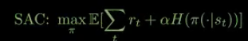

## Advantages of SAC

1. Sample Efficiency through off-policy net + Replay buffer: 
   Re-uses past interactions multiple times to train policy.
2. Stable Training due to double Q networks:
   single critic Q can be unstable or overestimate; taking min of 2 Qs, makes it stable
3. Automatically balances exploration and exploitation: 
   Through entropy maximization

## Takeaways:

1. SAC = Actor Critic + Entropy Maximization
2. Uses 2 Critics (Q1, Q2) for stability
3. Maximizes Reward and Entropy
4. Excellent for continuous control



## HOW TO RUN THE CODE?

**Train:** 
```bash
python train.py \
--env LunarLanderContinuous-v3 \
--steps 200000 \
--seed 42 \
--batch-size 256 \
--learning-starts 5000 \
--eval-freq 10000 \
--eval-episodes 5 \
--auto-entropy-tuning
```

```bash
python train.py --env CarRacing-v3 \
   --steps 200000 \
   --auto-entropy-tuning
```

**EVAL:**
```bash
python simulate.py \
  --env LunarLanderContinuous-v3 \
  --checkpoint runs/LunarLanderContinuous-v3/best.pth \
  --episodes 10 \
  --seed 123
```

**SIM:**
```bash
python simulate.py \
  --env BipedalWalker-v3 \
  --checkpoint runs/BipedalWalker-v3/best.pth \
  --episodes 3 \
  --render
```

```bash
python simulate.py \
  --env LunarLanderContinuous-v3 \
  --checkpoint runs/LunarLanderContinuous-v3/best.pth \
  --episodes 3 \
  --render
```

```bash
python simulate.py --env CarRacing-v3 \
   --checkpoint runs/CarRacing-v3/best.pth \
   --episodes 10 \
   --render
```

To visualize actions, use this flag:
```bash
--visualize-actions
```

# How to train with imitation learning?
```bash
python train.py --env CarRacing-v3 \
  --bc-checkpoint demos/human/bc_actor.pth \
  --demo-dir demos/human --demo-ratio 0.3 \
  --learning-starts 1000 \
  --steps 100000 \
  --eval-freq 5000 \
  --checkpoint-freq 0
```

```text
MixedReplayBuffer draws 30% of every update batch from demos, 70% from online experience — demos stay in the buffer permanently, so the BC prior isn't washed out early.
Demos are not baked into replay_buffer.pth; on --resume, just pass the same --demo-dir and they reload.
--demo-ratio 0 falls back to plain SAC.

```

### BC + PRE-TRAIN + TRAIN
```bash
# 1. let the decent 150k policy drive; take over when it drifts
python play_and_record.py --out-dir demos/human \
  --policy-checkpoint runs/CarRacing-v3/checkpoint_150k.pth --action-repeat 2

# 2. now BC on the enlarged demo set, and VALIDATE it
python pretrain_bc.py --demo-dir demos/human --epochs 40 --loss tanh --eval-episodes 10

# 3. only if the rollout mean is > ~150:
python train.py --env CarRacing-v3 \
  --bc-checkpoint demos/human/bc_actor.pth \
  --demo-dir demos/human --demo-ratio 0.3 \
  --auto-entropy-tuning --learning-starts 1000
```