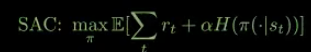

## Advantages of SAC

1. Sample Efficiency through off-policy net + Replay buffer: 
   Re-uses past interactions multiple times to train policy.
2. Stable Training due to double Q networks:
   single critic Q can be unstable or overestimate; taking min of 2 Qs, makes it stable
3. Automatically balances exploration and exploitation: 
   Through entropy maximization

## Takeaways:

1. SAC = Actor Critic + Entropy Maximization
2. Uses 2 Critics (Q1, Q2) for stability
3. Maximizes Reward and Entropy
4. Excellent for continuous control



## HOW TO RUN THE CODE?

**Train:** 
```bash
python train.py \
--env LunarLanderContinuous-v3 \
--steps 200000 \
--seed 42 \
--batch-size 256 \
--learning-starts 5000 \
--eval-freq 10000 \
--eval-episodes 5 \
--auto-entropy-tuning
```

```bash
python train.py --env CarRacing-v3 \
   --steps 200000 \
   --auto-entropy-tuning
```

**EVAL:**
```bash
python simulate.py \
  --env LunarLanderContinuous-v3 \
  --checkpoint runs/LunarLanderContinuous-v3/best.pth \
  --episodes 10 \
  --seed 123
```

**SIM:**
```bash
python simulate.py \
  --env LunarLanderContinuous-v3 \
  --checkpoint runs/LunarLanderContinuous-v3/best.pth \
  --episodes 3 \
  --render
```

```bash
python simulate.py --env CarRacing-v3 \
   --checkpoint runs/CarRacing-v3/best.pth 
   --episodes 10 
   --render
```
